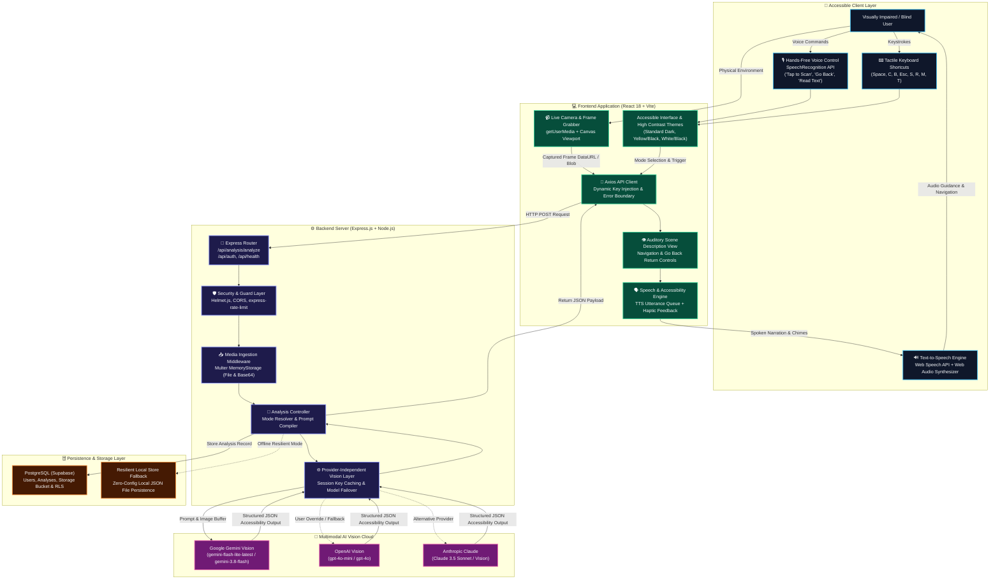

# 👁️ DRISHTI — "Eyes for the Blind"
### Real-Time AI Accessibility Assistant for Visually Impaired Users

Drishti is a full-stack, production-ready accessibility application designed to empower visually impaired and blind individuals to explore, understand, and navigate their surroundings independently through computer vision, scene narration, OCR reading, and hazard alerts.

---

## 🚀 Key Highlights & Capabilities

* **Live Camera Viewfinder**: WebRTC / `getUserMedia` camera feed with camera flipping (rear/front), flashlight/torch control, and instant photo upload fallback.
* **Provider-Independent Vision AI Layer**: Decoupled AI architecture in `src/services/aiService.js` supporting **Google Gemini Vision** (`gemini-1.5-flash`), **OpenAI Vision** (`gpt-4o-mini`, `gpt-4o`), **Anthropic Claude**, and local vision models.
* **Structured Accessibility Reasoning**:
  * 🔊 **Instant Spoken Summary**: 1–2 sentence overview designed for immediate speech synthesis.
  * ⚠️ **Obstacle & Safety Warnings**: Automatic detection of steps, tripping hazards, wet floors, and low ceilings with high-severity alert banners and auditory warning chimes.
  * 📝 **Document & Signage OCR**: Verbatim transcription of signs, paperwork, menus, product labels, and expiration dates.
  * 🧭 **Actionable Movement Guidance**: Relative directional advice (e.g., *"Clear for 4 feet, then pivot slightly right"*).
  * 📦 **Identified Objects**: Proximity estimation and spatial locations.
* **6 Specialized Vision Modes**:
  1. `General Scene`: Comprehensive spatial breakdown of the room or environment.
  2. `Text & OCR`: Focused reading of labels, packaging, bills, and books.
  3. `Obstacles & Safety`: Scrutinizes floor, stairs, and drop-offs.
  4. `Currency & Items`: Identifies banknotes, credit cards, coins, and keys.
  5. `People & Faces`: Detects human presence, count, and approximate distance.
  6. `Ask Drishti (Q&A)`: Voice or text question dialog allowing direct inquiries about the scene.
* **Text-to-Speech Engine**: Browser Speech Synthesis API with voice selection, speech speed rate tuning (0.75x–2.0x), pitch tuning, auto-speak, pause, and replay.
* **Web Audio API Synthesizer**: Custom offline synthesized chime frequencies for capture, alert, and success notifications.
* **High-Contrast Accessibility Themes**:
  * *Standard Dark* (Emerald & Slate)
  * *Yellow on Black* (Maximum luminance contrast for low-vision users)
  * *White on Black* (Monochrome clarity)
* **Full Keyboard Accessibility**:
  * <kbd>Space</kbd> or <kbd>C</kbd>: Capture image & describe surroundings
  * <kbd>S</kbd>: Stop audio speech narration
  * <kbd>R</kbd>: Replay narration from start
  * <kbd>M</kbd>: Cycle through 6 vision modes
  * <kbd>T</kbd>: Cycle contrast themes
  * <kbd>?</kbd>: Read keyboard shortcuts aloud

---

## 🏗️ System Architecture

### 📊 End-to-End Visual Architecture Diagram



### 🔄 End-to-End Visual Dataflow Pipeline

```
[ Camera Stream / Photo Upload ]
              │
              ▼
[ Canvas Image Capture (Blob / Base64) ]
              │
              ▼
[ Frontend: Axios Client + Voice / Keyboard Trigger ]
              │  (POST /api/analysis/analyze)
              ▼
[ Backend: Rate Limiting & Multer Memory Ingestion ]
              │
              ▼
[ Analysis Controller: Mode Prompt Dispatcher ]
              │  (General, Text, Find, Hazards, Currency, QA)
              ▼
[ aiService: Multimodal LLM Reasoning (Google Gemini / OpenAI / Claude) ]
              │  (Sub-second Latency Reasoning & Clock-Face Mapping)
              ▼
[ Structured JSON Output: Summary, Hazards, OCR Text, Currency INR, Objects ]
              │
              ▼
[ Persistence: Supabase PostgreSQL / Local Resilient Store ]
              │
              ▼
[ Auditory Scene Description View: Top/Bottom Go Back Navigation ]
              │
              ▼
[ Speech Engine: Real-Time Vocalized Narration & Return Guidance ]
```

### 🧩 System Architecture Layer Breakdown

| Architectural Layer | Technologies | Core Responsibilities & Capabilities |
| :--- | :--- | :--- |
| **User Interaction** | Web Speech API, Web Audio API, Vibration API, Tactile Hotkeys | Hands-free voice recognition, vocal alerts, screen reader announcements (`aria-live`), luminance-contrast themes, physical haptic buzzes. |
| **Frontend Core** | React 18, Vite 5, Tailwind CSS, Lucide Icons, Error Boundary | Camera feed (`getUserMedia`), frame snapshotting, Auditory Scene Description screen with top/bottom return navigation, state machines. |
| **API Gateway** | Express.js 4, Node.js 20, Helmet, CORS, express-rate-limit | Input sanitization, brute-force throttling, multi-format media ingestion (multipart/form-data & JSON base64 data URLs), routing. |
| **Vision AI Engine** | Google Gemini Vision (`gemini-flash-lite-latest`), OpenAI Vision, Claude | Scene decomposition, clock-face spatial locating, Indian Rupee notes & coins calculation, hazard warning generation, verbatim OCR transcription. |
| **Storage & State** | Supabase PostgreSQL, Row Level Security (RLS), Local JSON Store | User authentication, historical analyses persistence, resilient zero-config offline fallback store. |

### 📂 Directory & Component Structure

```bash
DRISHTI/
├── backend-drishti/         # Node.js + Express.js MVC Backend
│   ├── src/
│   │   ├── config/          # Environment variables & Supabase client
│   │   ├── controllers/     # Auth, Analysis, User, Health controllers
│   │   ├── database/        # Supabase PostgreSQL schema & localStore fallback
│   │   ├── middleware/      # JWT auth, Rate limiters, Multer upload, Errors
│   │   ├── routes/          # REST API endpoints (/api/analysis, /api/auth, /api/health)
│   │   ├── services/        # aiService.js (Provider-Independent Vision) & supabaseService.js
│   │   ├── utils/           # JWT & structured logger
│   │   ├── app.js           # Express app setup & middleware
│   │   └── server.js        # Server entrypoint (Port 5001)
│   ├── .env.example
│   └── package.json
│
└── frontend-drishti/        # React + Vite + Tailwind CSS Frontend
    ├── public/              # Favicon & accessible SVG assets
    ├── src/
    │   ├── components/      # Navbar, CameraView, CaptureButton, AnalysisResult, SpeechPlayer, ErrorBoundary
    │   ├── contexts/        # AuthContext, SpeechContext, AccessibilityContext, VoiceControlContext
    │   ├── hooks/           # useCamera, useKeyboardShortcuts
    │   ├── pages/           # AssistantPage, HistoryPage, SettingsPage
    │   ├── services/        # Axios API client & analysisService
    │   ├── styles/          # Tailwind & High-contrast themes (Standard, Yellow/Black, White/Black)
    │   ├── App.jsx          # Router & layout
    │   └── main.jsx
    ├── index.html
    ├── tailwind.config.js
    ├── vite.config.js
    └── package.json
```

---

## 🛠️ Getting Started

### 1. Prerequisites
- **Node.js** v18+ and **npm** installed.
- (Optional) Free **Google Gemini API Key** from [Google AI Studio](https://aistudio.google.com/app/apikey).
- (Optional) Free **Supabase** account from [supabase.com](https://supabase.com).
  *(Note: If Supabase keys are not set, Drishti automatically uses its resilient local storage with full persistence!)*

---

### 2. Backend Setup (`backend-drishti`)

```bash
cd backend-drishti

# Install dependencies
npm install

# Configure environment variables
cp .env.example .env
```

Edit `.env` to configure your AI Key and Supabase credentials:
```env
PORT=5001
JWT_SECRET=your_jwt_secret_here

# Provider-Independent AI Configuration
AI_PROVIDER=gemini
AI_API_KEY=YOUR_GEMINI_API_KEY
AI_MODEL=gemini-1.5-flash

# Supabase (Optional - system falls back to resilient local store if left empty)
SUPABASE_URL=https://your-project.supabase.co
SUPABASE_ANON_KEY=your-anon-key
```

Start the backend:
```bash
# Production start
npm start

# Or Development watch mode
npm run dev
```
Backend will be live at `http://localhost:5001`.

---

### 3. Frontend Setup (`frontend-drishti`)

```bash
cd ../frontend-drishti

# Install dependencies
npm install

# Start Vite dev server
npm run dev
```
Frontend will be live at `http://localhost:5173`.

---

## 🗄️ Supabase PostgreSQL Setup & Row Level Security

To use Supabase PostgreSQL and Storage:
1. Open your Supabase Project SQL Editor.
2. Paste and run the contents of [`DRISHTI/backend-drishti/src/database/supabase_schema.sql`](backend-drishti/src/database/supabase_schema.sql).
3. Create a public storage bucket named `drishti-images`.

---

## 🔒 Security Best Practices
- **Helmet.js** protection for HTTP security headers.
- **CORS** whitelisting for authorized frontend domains.
- **express-rate-limit** DDoS & API brute-force throttling.
- **JWT Authentication** with password hashing via `bcryptjs`.
- **Protected Endpoints** for user history and preference management.
- **Zero API Key Leakage**: AI API keys are stored exclusively in backend `.env` or header overrides.
